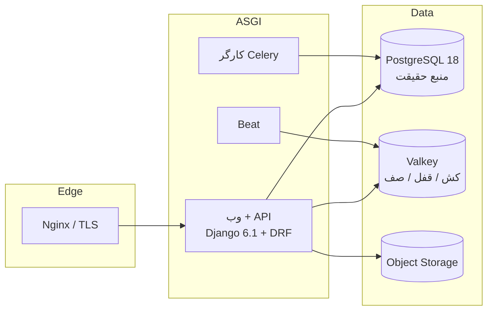

# مهدیه · Mahdieh

> **زائرسرای مهدیه — سامانهٔ رزرو و مدیریت اقامت**
> رزرو رایگان، تخصیص عادلانه، و **تضمین ریاضی** که هیچ‌گاه دو زائر برای یک اتاق بی‌جا نمی‌مانند.

[](https://github.com/mohebbibrothers/Mahdieh/actions/workflows/ci.yml)
[](https://github.com/mohebbibrothers/Mahdieh/actions/workflows/codeql.yml)


[](LICENSE)

---

## این پروژه چیست؟

زائرسرای مهدیه در مشهد، **۵ واحد اقامتی** دارد:

| طبقه | واحدها |
|---|---|
| اول | ۱ سوئیت + ۱ اتاق بزرگ |
| دوم | ۱ سوئیت + ۱ اتاق بزرگ |
| سوم | ۱ اتاق بزرگ |

زائران با **شمارهٔ تلفن** ثبت‌نام می‌کنند (بدون ایمیل)، پروفایل خود را تکمیل می‌کنند و سپس می‌توانند آزادانه‌ترین بازه‌ها را ببینند و رزرو کنند. اقامت **کاملاً رایگان** است؛ پس دشمنِ سیستم «پرداخت» نیست، **دوباره‌رزروی و بی‌عدالتی** است.

> **فلسفهٔ مهندسی:** این پروژه یک CRUD ساده روی جدول رزرو نیست. یک **سیستم تخصیص منبع کمیابِ رایگان** است. تمام تصمیم‌های معماری از این جمله بیرون آمده‌اند.

---

## چرا این پروژه در سطح «قله» است؟

| تضمین | چگونه محقق شده | چگونه اثبات می‌شود |
|---|---|---|
| **هیچ دوباره‌رزروی ممکن نیست** | قید `EXCLUDE USING gist` در PostgreSQL، نه بررسی در پایتون | تست همزمانی با دو تراکنش موازی در CI |
| **رزرو هرگز به پیامک گره نمی‌خورد** | الگوی **Transactional Outbox** در همان تراکنش | تست: خطای پیامک ⇒ رزرو سالم می‌ماند |
| **کش هیچ‌گاه کهنه نمی‌ماند** | ابطال بر پایهٔ **Epoch** روی Valkey | تست: پس از رزرو، تقویم بلافاصله تازه است |
| **قواعد بدون دیپلوی تغییر می‌کنند** | سیاست‌ها دادهٔ **نسخه‌دار** هستند | تست: تغییر سیاست ⇒ نسخهٔ جدید + حسابرسی |
| **سابقهٔ عملیات قابل‌دستکاری نیست** | زنجیرهٔ هش + لنگر روزانه | تست: دستکاری رکورد ⇒ زنجیره می‌شکند و CI می‌فهمد |
| **معماری قابل‌انحراف نیست** | تست‌های AST روی `views.py` | تست: نوشتن مستقیم مدل در view ⇒ ساخت شکست می‌خورد |
| **قرارداد API استاندارد جهانی است** | خطاها **RFC 9457**، کش **RFC 9111**، نسخه‌بندی **RFC 8594** | اعتبارسنجی OpenAPI در CI |
| **گزارش اکسل، سندِ قابل‌ارجاع است** | خروجی هفت‌برگی **بایت‌به‌بایت بازتولیدپذیر** + هش SHA-256 | تست: دو بار گرفتن گزارش ⇒ فایل و هش یکسان |

---

## کالای تحویل‌شده تا این لحظه

```text
docs/architecture/00-BLUEPRINT.md      سند معماری جامع (C4، ماژول‌ها، SLO، مدل تهدید)
docs/architecture/01-DOMAIN-MODEL.md   مدل دامنه، ۱۴ ثابت، ماشین حالت، رخدادها، سیاست‌ها
docs/architecture/02-ROADMAP.md        نقشهٔ راه ۸ فازی با معیار پذیرش هر فاز
docs/adr/0001..0012                    دوازده تصمیم معماری مکتوب با گزینه‌های ردشده
src/apps/core                          هستهٔ مشترک: BaseModel، RFC 9457، Outbox، Idempotency، رمزنگاری، UUIDv7، تقویم جلالی
src/apps/identity                      هویت تلفن‌محور: ورود با کد یک‌بارمصرف، پروفایل زائر، کد ملی رمزنگاری‌شده
src/apps/inventory                     موجودی: ۳ طبقه، ۵ واحد، امکانات، بلوک نگهداری، شبکهٔ نیم‌روزی
src/apps/reservation                   دامنهٔ رزرو: سیاست‌های نسخه‌دار، ماشین حالت، تضمین عدم‌همپوشانی، هم‌توانی
src/apps/notifications                 پیامک: پورت ارائه‌دهنده + آداپتور ماک، قالب‌های فارسی، حاکمیت ارسال
src/apps/reporting                     گزارش‌گیری: خروجی اکسل هفت‌برگی، خلاصهٔ مدیریتی، ممیزی خروجی
src/apps/audit                         حسابرسی با زنجیرهٔ هش
src/tests                              ۱۶۸ تست: واحد، API، معماری (AST)، هم‌زمانی روی PostgreSQL واقعی
src/config                             تنظیمات چندمحیطی، ASGI/WSGI، مسیرها
```

---

## شروع سریع

### پیش‌نیاز

- Python **3.13** یا **3.14**
- [`uv`](https://docs.astral.sh/uv/) (مدیر پکیج و محیط)
- Docker (برای Postgres/Valkey) — یا نصب بومی

### راه‌اندازی

```bash
git clone https://github.com/mohebbibrothers/Mahdieh.git
cd Mahdieh

cp .env.example .env                 # مقادیر توسعهٔ امن از پیش پر شده‌اند
make services-up                      # Postgres 18 + Valkey + MinIO + Mailpit

make install                          # uv sync --all-extras
make migrate                          # مهاجرت‌های دیتابیس
make seed                             # دادهٔ نمونه: ۳ طبقه و ۵ واحد واقعی
make run                              # http://127.0.0.1:8000

# دادهٔ نمایشی و گزارش اکسل از خط فرمان
uv run python src/manage.py seed_demo                      # زائر، رزرو، لغو، پذیرش و بلوک نمونه
uv run python src/manage.py export_report --from 2026-10-01 --to 2026-10-31 --out report.xlsx
```

### گزارش اکسل (هفت برگه)

| برگه | چه می‌گوید |
|---|---|
| راهنما | بازه، جمع‌بندی مدیریتی، تفکیک وضعیت‌ها و **اثر انگشت SHA-256 محتوا** |
| رزروها | هر رزرو: کد، وضعیت، واحد، تاریخ شمسی، مدت، نفرات، تلفن **پوشانده** |
| تقویم سانس‌ها | وضعیت هر نیم‌روز هر واحد: آزاد / اشغال / بافر نظافت / غیرقابل‌رزرو |
| اشغال واحدها | کارنامهٔ هر واحد: نیم‌روزها، شب‌ها و نرخ اشغال |
| آمار روزانه | نبض روزبه‌روز: اشغال، ورودی، خروجی و سطح تقاضا |
| کنش‌های کارکنان | چه کسی، چه زمانی، چه کاری و **با چه دلیلی** |
| پیامک‌ها | حاکمیت ارسال با شمارهٔ پوشانده |

خروجی سرور: `GET /api/v1/staff/reports/reservations.xlsx?from=…&to=…` (فقط کارکنان)
با هدرهای `X-Report-SHA256` و `Content-Disposition`؛ هر خروجی در زنجیرهٔ حسابرسی
با کنش `export.requested` ثبت می‌شود.

### دستورها

```bash
make check        # گیت سریع: ruff + mypy + تست‌های واحد
make verify       # گیت کامل انتشار (همان چیزی که CI اجرا می‌کند)
make test         # همهٔ تست‌ها روی Postgres/Valkey واقعی (شامل هم‌زمانی)
make test-fast    # فقط واحد + معماری (بدون IO)
make lint         # ruff check --no-fix (عدم اصلاح خودکار در CI)
make typecheck    # mypy --strict
make security     # bandit + pip-audit
make docs         # بازتولید STRUCTURE.md و بررسی drift
make help         # فهرست همهٔ هدف‌ها
```

---

## معماری در یک نگاه



**هشت ماژول با مرزهای اجراشده:** `core` · `identity` · `inventory` · `reservation` · `notifications` · `operations` · `reporting` · `audit`

قرارداد هر ماژول: `models` → `domain` (کسب‌وکار خالص) → `selectors` (خواندن) / `services` (نوشتن) → `serializers` → `views` (فقط HTTP).
انحراف از این مسیر در CI **شکست** می‌خورد، نه در بازبینی انسانی.

---

## استک

| لایه | انتخاب | چرا |
|---|---|---|
| زبان | Python 3.13 / 3.14 | آخرین نسخه‌هایی که Django 6.1 رسماً پشتیبانی می‌کند |
| فریمورک | Django 6.1.2 | fetch mode ضد N+1، `on_delete` سطح دیتابیس، CSP بومی |
| API | DRF 3.18.3 + drf-spectacular | بالغ‌ترین لایهٔ API جنگو؛ OpenAPI 3.1 به‌عنوان قرارداد |
| ارائه | SSR + HTMX + Alpine | سرعت روی شبکهٔ ضعیف، SEO، سادگی عملیاتی |
| دیتابیس | PostgreSQL 17/18 + `btree_gist` | قید Exclusion برای تضمین عدم‌همپوشانی |
| کش/صف | Valkey (پروتکل Redis) | مجوز باز، atomic slot migration، کارایی بالاتر |
| کار پس‌زمینه | Celery 5.6 | بالغ، قابل اعتماد، با روتینگ و اولویت |
| کیفیت | ruff + mypy --strict + pytest + Hypothesis | صفر هشدار، صفر بدهی تایپ، تحمل‌پذیری تست |
| امنیت | bandit + Semgrep + CodeQL + pip-audit + gitleaks | زنجیرهٔ تأمین و SAST چندلایه |

> **قاعدهٔ ابزار:** هیچ ابزار سنگینی بدون «شرط فعال‌سازی مکتوب» وارد نمی‌شود. Kafka، ClickHouse، Kubernetes و OpenSearch امروز **خاموش** هستند — چون در مقیاس ۵ واحد اقامتی، هزینه‌اند نه ارزش. شرط‌های روشن‌شدنشان در [سند معماری](docs/architecture/00-BLUEPRINT.md) بخش ۱۵ آمده است.

---

## کیفیت و گیت‌ها

```text
ruff (lint + format check)        صفر هشدار، بدون اصلاح خودکار در CI
mypy --strict                     صفر خطا، بدون type: ignore بی‌دلیل
pytest روی Postgres/Valkey واقعی   SQLite در تست ممنوع (رفتار تولید باید آزموده شود)
تست‌های معماری (AST)              هر تخلف لایه = شکست ساخت
تست‌های همزمانی                   تضمین عدم‌دوباره‌رزروی، Outbox، Idempotency
coverage با گیت راتچت             کاهش پوشش = شکست
bandit + pip-audit + CodeQL       صفر یافتهٔ با شدت بالا
گیت مستندات                       مستند کهنه یا ناهمخوان با کد = شکست
قرارداد محیط                      .env.example با تنظیمات هم‌خوانی اجباری
```

---

## مستندات

| سند | محتوا |
|---|---|
| [سند معماری جامع](docs/architecture/00-BLUEPRINT.md) | زمینه و ظرف، ماژول‌ها، داده، API، امنیت، SLO، مدل تهدید |
| [مدل دامنه](docs/architecture/01-DOMAIN-MODEL.md) | زبان فراگیر، موجودیت‌ها، ۱۴ ثابت، ماشین حالت، سیاست‌ها |
| [نقشهٔ راه](docs/architecture/02-ROADMAP.md) | هشت فاز با معیار پذیرش و ریسک‌ها |
| [تصمیم‌های معماری](docs/adr/) | ۱۲ ADR با زمینه، تصمیم، پیامد و گزینه‌های ردشده |
| `STRUCTURE.md` | ساختار واقعی مخزن (خودتولید، با گیت drift) |

---

## امنیت

- آسیب‌پذیری‌ها را **عمومی گزارش نکنید**؛ مسیر [SECURITY.md](SECURITY.md).
- دادهٔ حساس (کد ملی، تلفن کامل) رمزنگاری‌شده ذخیره و در لاگ‌ها پوشانده می‌شود.
- نشست‌ها کوکی‌امن با ابطال فوری؛ کارکنان با احراز دومرحله‌ای و «احراز تازه» برای عملیات مخرب.

## مشارکت

[CONTRIBUTING.md](CONTRIBUTING.md) — قراردادهای کامیت، شاخه، تست و بازبینی.

## مجوز

[MIT](LICENSE) © ۲۰۲۶ — زائرسرای مهدیه
