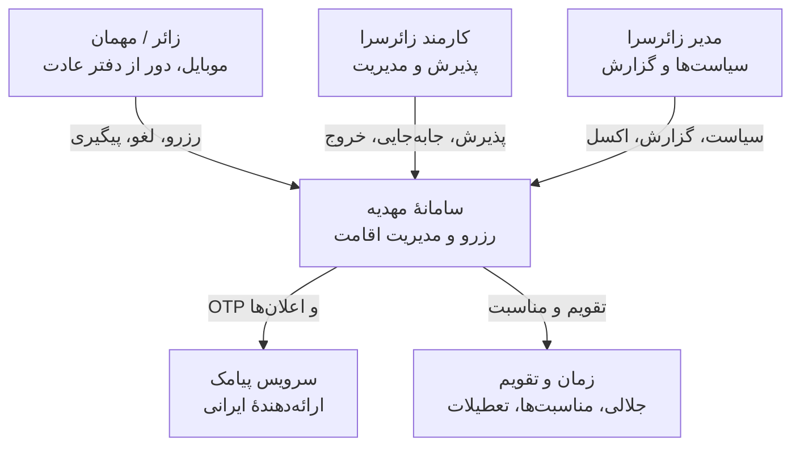
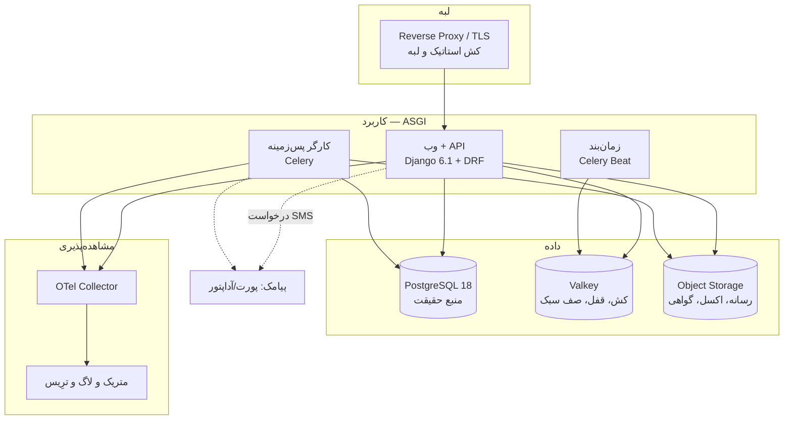
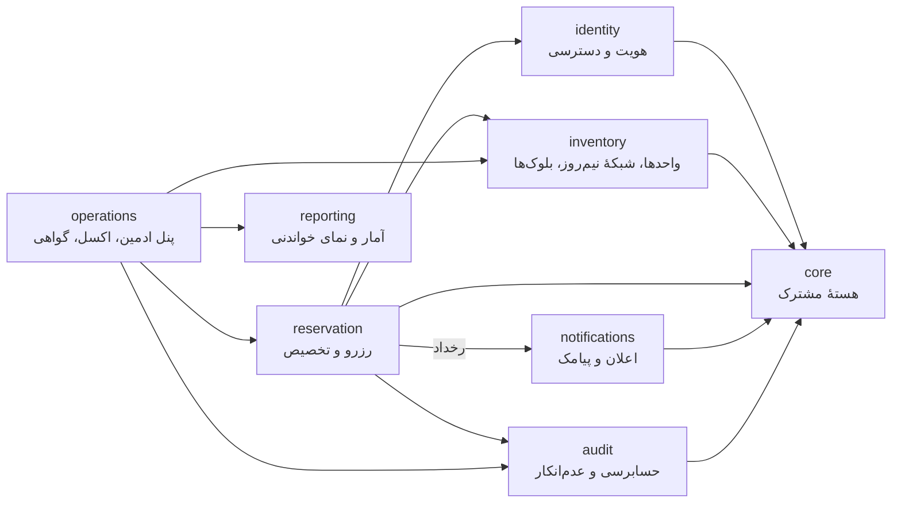
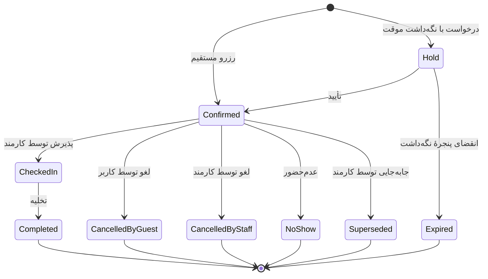

# مهدیه / Mahdieh — سند معماری جامع

> **نسخه:** ۱.۰ · **تاریخ:** ۲۰۲۶-۱۰-۱۵ · **وضعیت:** پیشنهاد مصوبِ معمار (مبنای فاز ۰)
> **دامنه:** زائرسرای سه‌طبقه در مشهد — ۳ سوئیت + ۲ اتاق بزرگ (۵ واحد) · رزرو کاملاً رایگان
> **سندهای همراه:** [`01-DOMAIN-MODEL.md`](01-DOMAIN-MODEL.md) · [`02-ROADMAP.md`](02-ROADMAP.md) · [`../adr/`](../adr/)

---

## ۱. خلاصهٔ اجرایی

مهدیه یک «سایت رزرو» نیست؛ یک **سیستم تخصیص منبع کمیابِ رایگان** است. پنج واحد اقامتی، تقاضای فصلی و موجی (نوروز، رمضان، محرم، صفر، اربعین)، قیمت صفر، و کاربرانی که با موبایل و اینترنت ضعیف وارد می‌شوند. در چنین سیستمی، دشمن اصلی «پرداخت» نیست؛ سه چیز است:

۱. **دوباره‌رزروی (Overbooking)** — مطلقاً نباید ممکن باشد، حتی زیر همزمانی شدید.
۲. **بی‌عدالتی در تخصیص** — چون پول در میان نیست، صف و نوبت باید منصفانه، شفاف و قابل‌دفاع باشد.
۳. **تجربهٔ ضعیف روی موبایل** — کاربر باید در چند لمس، بدون ایمیل، بدون سردرگمی، رزرو کند.

معماری مهدیه حول همین سه محور ساخته شده:

| محور | پاسخ معماری | کجا اجرا می‌شود |
|---|---|---|
| دوباره‌رزروی | **قید Exclusion در خودِ PostgreSQL** روی بازهٔ زمانی هر واحد | سطح دیتابیس — غیرقابل‌دورزدن |
| عدالت | **موتور سیاست تخصیص عادلانه (Fair-Use & Allocation Engine)** + لیست انتظار با پیشنهاد خودکار | سطح سرویس — قابل‌تنظیم و ممیزی‌شده |
| تجربه | **SSR + HTMX + Alpine** با تقویم جلالی بومی، طراحی موبایل‌اول، و کش لبه‌ای تهاجمی | سطح ارائه — سرعت بالا، SEO، بدون پیچیدگی SPA |

**اصل معماری حاکم:** یک **مونولیت ماژولار** با مرزهای داخلی سخت‌گیرانه و یک هستهٔ رویدادمحور (Transactional Outbox). هر ماژول می‌تواند روزی به سرویس مستقل جدا شود، اما امروز جدا نیست — چون ۵ واحد اقامتی، میکروسرویس لازم ندارد، **انضباط** لازم دارد.

---

## ۲. صورت مسئله و بینش طراحی

### ۲.۱ دامنهٔ کسب‌وکار

```text
زائرسرا: ۳ طبقه
├── طبقهٔ ۱: سوئیت A۱ + اتاق بزرگ B۱
├── طبقهٔ ۲: سوئیت A۲ + اتاق بزرگ B۲
└── طبقهٔ ۳: اتاق بزرگ B۳
مجموع: ۵ واحد اقامتی
```

- رزرو **کاملاً رایگان** (بدون درگاه پرداخت، بدون ودیعه)
- ثبت‌نام **فقط با شمارهٔ تلفن** (بدون ایمیل)
- تکمیل پروفایل: نام، نام خانوادگی، کد ملی، شهر، استان (پیش‌شرط باز شدن دسترسی رزرو)
- رزرو: تعداد نفرات + تاریخ/زمان تحویل
- حداقل مدت: **نصف روز** · حداکثر: **یک هفته** (قابل تغییر توسط ادمین در زمان اجرا)
- کاربر می‌تواند رزرو خود را لغو کند و سانس آزاد شود
- ادمین: جابه‌جایی سانس، لغو، رزرو از طرف کاربر، خروجی اکسل حرفه‌ای
- پنل پیامکی: اتصال در فاز ۵

### ۲.۲ بینش کلیدی: مسئلهٔ «صف» است نه «فروش»

در فروشگاه، تقاضای مازاد با **قیمت** تنظیم می‌شود. اینجا قیمت صفر است؛ پس تقاضای مازاد باید با **سیاست تخصیص** تنظیم شود. این تفاوت، معماری را از «CRUD ساده روی جدول رزرو» به یک سامانهٔ کامل تبدیل می‌کند:

```text
        فروشگاه (قیمت‌محور)              مهدیه (سیاست‌محور)
   ┌────────────────────────┐      ┌────────────────────────────────┐
   │ مازاد تقاضا → افزایش قیمت │      │ مازاد تقاضا → صف، سهمیه، اولویت │
   │ موجودی نامحدود فرضی      │      │ موجودی ذاتاً محدود: ۵ واحد      │
   │ لغو = بازگشت پول        │      │ لغو = بازگشت سانس به صف         │
   └────────────────────────┘      └────────────────────────────────┘
```

پس موتور تخصیص (ظرفیت هر کاربر، سهمیهٔ ایام پیک، اولویت گروه‌ها، جریمهٔ عدم‌حضور، پیشنهاد خودکار به لیست انتظار) **بخشی از معماری هسته است، نه یک افزودنی**.

### ۲.۳ آنچه از دامنه می‌دانیم و آنچه باید تأیید شود

| مورد | وضعیت | رفتار سیستم در حالت نامعلوم |
|---|---|---|
| ظرفیت هر واحد (تعداد نفر) | ❓ باید تأیید شود | پارامتر `capacity` به‌ازای هر واحد؛ مقدار پیش‌فرض محافظه‌کارانه |
| ساعت دقیق تحویل/تخلیه | ❓ باید تأیید شود | پارامتر `handover_times` در تنظیمات؛ پیش‌فرض ۱۴:۰۰ / ۱۲:۰۰ |
| ویو/مناظر/امکانات اتاق‌ها | ❓ باید تأیید شود | مدل `UnitFeature` با seed اولیه |
| سقف رزرو هم‌زمان هر کاربر | ❓ سیاستی | پیش‌فرض: **۱ رزرو فعال در آینده** (قابل تغییر) |
| سقف نیم‌روز در بازهٔ چرخشی | ❓ سیاستی | پیش‌فرض: ۱۴ نیم‌روز در ۳۰ روز (قابل تغییر) |
| جریمهٔ عدم‌حضور | ❓ سیاستی | پیش‌فرض: علامت‌گذاری + محرومیت موقت ۷ روز (قابل تغییر) |
| سهمیهٔ ایام پیک | ❓ سیاستی | پیش‌فرض خاموش؛ ساختار آماده برای فعال‌سازی |

> **قاعدهٔ پروژه:** هر مقداری که «سیاست» است، در کد هاردکد نمی‌شود؛ در جدول `Policy` با **نسخه، بازهٔ اعتبار، سازنده و ممیزی** ذخیره می‌شود. تغییر سیاست = یک رکورد جدید، نه یک دیپلوی.

---

## ۳. اصول هدایت‌کننده

این ده اصل، معیار هر تصمیم فنی در این پروژه‌اند. انحراف از هر اصل فقط با یک ADR ممکن است.

| # | اصل | معنای عملی در مهدیه |
|---|---|---|
| ۱ | **درستی قبل از هوشمندی** | اول تضمین «هیچ‌گاه دوباره‌رزرو نشود»، بعد زیبایی و فیچر |
| ۲ | **قید را به قوی‌ترین لایه ببر** | محدودیت‌های ذاتی (عدم‌همپوشانی) در **دیتابیس**، نه در پایتون |
| ۳ | **کاربرپسندی، یک الزام معماری است** | تعداد لمس، سرعت روی 3G، تقویم جلالی — همه معیار پذیرش دارند |
| ۴ | **مرزها را کد بزن، نه توصیه** | تفکیک لایه‌ها با تست معماری در CI اجرا می‌شود |
| ۵ | **هر سیاست، یک رکورد قابل‌ممیزی** | ظرفیت، حداقل/حداکثر، سهمیه — همه در جدول Policy با نسخه |
| ۶ | **مانع شکست، نه مدیریت شکست** | Outbox به‌جای «تلاش دوباره در حافظه»؛ Idempotency به‌جای «امیدواریم دوبار نیاید» |
| ۷ | **مشاهده‌پذیری از روز اول** | رخداد دامنه‌ای مثل «تصادم رزرو» باید یک متریک داشته باشد، نه یک لاگ گم‌شده |
| ۸ | **سادگیِ قابل‌دفاع** | هیچ ابزاری بدون شرط فعال‌سازی مشخص وارد نمی‌شود (بخش ۱۵) |
| ۹ | **حفظ حریم خصوصی دادهٔ زائر** | کد ملی رمزنگاری‌شده، دسترسی ممیزی‌شده، کمینه‌سازی داده |
| ۱۰ | **مهاجرت‌پذیری** | هر انتخاب باید یک «مسیر ترک» مکتوب داشته باشد (کش، پیامک، ذخیره‌سازی، IdP) |

---

## ۴. مرزهای سیستم — نمای زمینه و ظرف

### ۴.۱ نمای زمینه (C4 L1)



### ۴.۲ نمای ظرف (C4 L2)



---

## ۵. معماری کلان: مونولیت ماژولار با انضباط اجراشده

### ۵.۱ چرا مونولیت ماژولار (نه میکروسرویس)

۵ واحد اقامتی، اوج بار در یک روز پیک شاید چند ده هزار درخواست در روز باشد. میکروسرویس در این مقیاس، **هزینه بدون فایده** است: پیچیدگی شبکه، تراکنش توزیع‌شده، و از دست رفتن سادگی. اما بی‌نظمی هم پذیرفتنی نیست. پس: یک فرآیند، مرزهای روشن، و **قابلیت جداسازی** در آینده.

### ۵.۲ قرارداد ثابت هر ماژول

هر ماژول (Django app) دقیقاً از این ساختار پیروی می‌کند. تفکیک «خواندن» از «نوشتن» (CQRS سبک) و «دامنه» از «HTTP» در این قرارداد قفل شده است:

| فایل | مسئولیت | ممنوعیت‌ها |
|---|---|---|
| `models.py` | پایداری و قیدهای ذاتی | هیچ منطق چندمدلی، هیچ فراخوانی شبکه |
| `choices.py` | شمارشی‌های دامنه | — |
| `domain/` | قاعدهٔ کسب‌وکار خالص، ماشین حالت، سیاست‌ها | **هیچ import از Django ORM/HTTP** |
| `selectors.py` | خواندن بهینه، بدون side-effect | ممنوعیت هر نوشتنی |
| `services.py` | نوشتن، تراکنش، رخداد، side-effect | ممنوعیت دسترسی مستقیم به `request` |
| `serializers.py` | قرارداد ورودی/خروجی | ممنوعیت قاعدهٔ کسب‌وکار سنگین |
| `permissions.py` | مجوزدهی | — |
| `throttles.py` | مرز نرخ و سوءاستفاده | — |
| `views.py` | فقط HTTP و ارکستراسیون | **ممنوعیت نوشتن مستقیم روی مدل/کوئری‌ست** |
| `urls.py` | قرارداد مسیر | — |
| `tasks.py` | کار پس‌زمینه | باید idempotent باشد |
| `events.py` | رخدادهای دامنهٔ منتشرشده | فقط از طریق Outbox |
| `tests/` | سناریو، مرز، قرارداد | — |

**تست‌های معماری در CI این قرارداد را اجرا می‌کنند** — تخلف = شکست ساخت. (مثال واقعی: تستی که AST همهٔ `views.py` را می‌خواند و هر `Model.objects.create/update/delete` را رد می‌کند.)

### ۵.۳ ماژول‌های (Bounded Contexts) مهدیه



| ماژول | مسئولیت | چیزهایی که مالک آن است |
|---|---|---|
| `core` | هستهٔ مشترک | `BaseModel`، پوشش خطا (Problem Details)، صفحه‌بندی، کش، **Outbox**، Idempotency، میان‌افزارها، تقویم جلالی، پرچم فیچر، سلامت، متریک |
| `identity` | هویت و دسترسی | کاربر، OTP، پروفایل، کد ملی (رمزنگاری‌شده)، نشست‌ها و دستگاه‌ها، نقش‌ها، ریسک |
| `inventory` | موجودی فیزیکی و زمان | ساختمان/طبقه/واحد، ظرفیت، **شبکهٔ نیم‌روز**، تعطیلات و مناسبت‌ها، بلوک‌های نگهداری |
| `reservation` | قلب سیستم | رزرو، ماشین حالت، **موتور تخصیص عادلانه**، لیست انتظار و پیشنهاد، سهمیه و اعتبارسنجی |
| `notifications` | ارتباط با کاربر | پورت ارائه‌دهندهٔ پیامک، قالب‌ها، لاگ تحویل، بازپخش، سهمیه و هزینه |
| `operations` | کار کارکنان | کنسول ادمین، جابه‌جایی، **موتور صادرات اکسل**، گواهی اقامت و QR، برگهٔ روز |
| `reporting` | خواندن تحلیلی | نماهای خواندنی، اشغال‌سنجی، کارنامهٔ مهمان، آمار عدم‌حضور |
| `audit` | عدم‌انکار | زنجیرهٔ هش، لنگر روزانهٔ WORM، بستهٔ فورنزیک |

---

## ۶. هستهٔ دامنه: مدل زمانی نیم‌روز

مدل کامل در [`01-DOMAIN-MODEL.md`](01-DOMAIN-MODEL.md). خلاصهٔ تصمیم:

- زمان به **سلول‌های نیم‌روز** افراز می‌شود (پیش‌فرض: نیم‌روزِ روزانه ۰۸:۰۰→۲۰:۰۰ و نیم‌روزِ شبانه ۲۰:۰۰→۰۸:۰۰)، **کاملاً قابل‌تنظیم**.
- هر رزرو = **بازهٔ پیوستهٔ** N سلول نیم‌روز، با `1 ≤ N ≤ 14` (نصف روز تا یک هفته، از جدول Policy).
- هر رزرو دو بازهٔ ذخیره‌شده دارد: `stay_period` (اقامت واقعی) و `block_period` (اقامت + بافر نظافت). قید عدم‌همپوشانی روی `block_period` اعمال می‌شود تا **فاصلهٔ نظافت** هم تضمین شود.
- نمایش به کاربر **جلالی** است؛ ذخیره‌سازی در دیتابیس با `timestamptz` و منطقهٔ زمانی `Asia/Tehran`.

---

## ۷. تضمین‌های صحت — «دوباره‌رزروی غیرممکن»

### ۷.۱ قید سطح دیتابیس

```sql
-- قلب تضمین: هیچ دو رزروِ فعال روی یک واحد نباید همپوشانی زمانی داشته باشند
ALTER TABLE reservation_reservation
  ADD CONSTRAINT reservation_no_overlap
  EXCLUDE USING gist (
    unit_id WITH =,
    block_period WITH &&        -- عمل‌گر همپوشانی بازه
  )
  WHERE (status IN ('hold','confirmed','checked_in') AND block_period IS NOT NULL);
```

سه ویژگی حیاتی این تصمیم:

۱. **غیرقابل‌دورزدن:** حتی کد باگ‌دار، اسکریپت دستی، یا دو ادمین هم‌زمان نمی‌توانند دوباره‌رزروی بسازند. خطا از `IntegrityError` برمی‌گردد و سرویس آن را به پاسخ دامنه‌ای تبدیل می‌کند.
۲. **بدون نیاز به قفل اپلیکیشنی:** نیازی به `select_for_update` روی همه‌چیز نیست؛ دیتابیس خودش سریالایز می‌کند.
۳. **قابل‌آزمون:** تست همزمانی واقعی روی Postgres (دو تراکنش موازی، دقیقاً یکی موفق) بخشی از سوئیت است.

### ۷.۲ لایه‌های مکمل

| تهدید | کنترل |
|---|---|
| دو درخواست هم‌زمان یک کاربر | Idempotency-Key + قید یکتایی روی کلید |
| جابه‌جایی هم‌زمان توسط دو ادمین | قفل خوش‌بینانه (`version`) + ۴۰۹ در تصادم |
| انبوه‌عملیات ادمین | قفل مشورتی Postgres روی واحد + تراکنش واحد + پیش‌نمایش تفاوت قبل از اعمال |
| رزرو در گذشته یا خیلی دور | اعتبارسنجی سرویس با ساعت مرجع سرور (نه کلاینت) |
| نگه‌داشت موقت رهاشده | «بازگردانندهٔ نگه‌داشت» که `block_period` را تهی می‌کند (نتیجه: بلافاصله آزاد می‌شود حتی پیش از پاک‌سازی) |

### ۷.۳ ماشین حالت رزرو



قواعد کلیدی: تنها وضعیت‌های **فعال** در قید عدم‌همپوشانی شرکت می‌کنند؛ هر انتقال با **نگهبان** (شرط)، **مجوز**، و **رخداد** همراه است؛ در ماشین حالت هیچ حالت «معلقِ بی‌قاعده» وجود ندارد.

---

## ۸. معماری داده و کش

### ۸.۱ اصول

- **Postgres تنها منبع حقیقت.** هیچ حالتی فقط در کش زندگی نمی‌کند.
- **UUIDv7** برای کلیدهای اصلی: مرتب با زمان (locality در درخت ایندکس)، غیرقابل‌حدس، بدون افشای شمارش رزروها.
- **زمان همه‌جا `timestamptz` با UTC در دیتابیس**؛ تبدیل به `Asia/Tehran` و جلالی فقط در لایهٔ ارائه.
- **محدودسازی PII:** کد ملی و شماره تلفن رمزنگاری‌شده (AES-GCM با کلید از محیط/KMS) + ستون هایش برای جست‌وجوی قطعی (HMAC) — نمایش فقط ۴ رقم آخر.

### ۸.۲ کش با ابطال دوره‌ای (Epoch-based Invalidation)

مسئله: تقویم رزرو باید تازه باشد ولی پرترافیک است. راه‌حل عمومی (حذف کلید به کلید) شکننده است. راه‌حل مهدیه:

```text
کلید کش:  availability:{unit_id}:{epoch}:{from}:{to}
شمارنده:  epoch  ← در Valkey، به‌ازای هر واحد
هر تغییر وضعیت رزرو ⇒ INCR epoch برای آن واحد ⇒ همهٔ کلیدهای قدیمی بی‌اثر می‌شوند
```

نتیجه: بدون پیمایش کلیدها، بدون مسابقه، همیشه سازگار. عدد `epoch` در پاسخ به‌عنوان نسخهٔ موجودی برمی‌گردد و در `ETag` می‌آید، پس مرورگر هم می‌تواند ۳۰۴ بگیرد.

| داده | سیاست | TTL | ابطال |
|---|---|---|---|
| تقویم موجودی | قابل کش عمومی، `stale-while-revalidate` | ۶۰ ثانیه | با `epoch` |
| فهرست واحدها و امکانات | تقریباً ایستا | ۱ ساعت | در تغییر محتوا |
| تعطیلات و مناسبت‌ها | ایستا | ۲۴ ساعت | سالانه |
| دادهٔ کاربر (رزروهای من) | خصوصی، `no-store` | — | — |
| آمار داشبورد ادمین | خصوصی، کوتاه | ۳۰ ثانیه | با رخداد رزرو |

### ۸.۳ Outbox رویدادمحور

هر تغییر مهم در **همان تراکنش** یک رکورد Outbox می‌نویسد. یک رلهٔ پس‌زمینه آن را در Valkey Streams منتشر می‌کند و مصرف‌کننده‌ها (اعلان، کش، آمار، حسابرسی) idempotent هستند.

```text
تراکنش رزرو ──┬──> جدول رزرو (منبع حقیقت)
              ├──> رکورد Audit
              └──> رکورد Outbox ──(رله)──> Valkey Streams ──> مصرف‌کننده‌ها
```

فایده: اگر پیامک قطع باشد، **رزرو سالم می‌ماند**؛ اعلان بعداً تحویل می‌شود. رزرو هرگز به سرویس بیرونی گره نمی‌خورد.

### ۸.۴ فهرست رخدادهای دامنه

| رخداد | مصرف‌کننده |
|---|---|
| `reservation.created` | اعلان، آمار، ابطال کش، حسابرسی |
| `reservation.confirmed` | اعلان، لیست انتظار (حذف از صف) |
| `reservation.cancelled` | اعلان، **پیشنهاد خودکار به لیست انتظار**، کش |
| `reservation.superseded` | اعلان، حسابرسی (زنجیرهٔ جابه‌جایی) |
| `reservation.checked_in` / `checked_out` / `no_show` | آمار، سیاست جریمه |
| `hold.expired` | کش، لیست انتظار |
| `block.created` / `block.removed` | کش، آمار اشغال |
| `export.requested` / `export.completed` | حسابرسی، ذخیره‌سازی |
| `policy.changed` | ابطال کش سیاست، حسابرسی |

---

## ۹. قرارداد API

### ۹.۱ اصول

| موضوع | تصمیم |
|---|---|
| سبک | REST منبع‌محور + OpenAPI 3.1 به‌عنوان **تنها منبع حقیقت** |
| نسخه‌بندی | `/api/v1/...` با سیاست مکتوب: دو نسخهٔ هم‌زمان حداقل، هدرهای `Deprecation` و `Sunset` (RFC 8594) |
| خطا | **RFC 9457 (Problem Details)** — نه پوشش سفارشی. دلیل در [ADR-0006](../adr/0006-problem-details-instead-of-envelope.md) |
| موفقیت | بدنهٔ خالص منبع + هدرها؛ پوشش `{success, data}` **حذف شد** (شکستن قرارداد عمدی و مستند) |
| هم‌توانی | هدر `Idempotency-Key` روی همهٔ نوشتن‌ها؛ نتیجهٔ نخست بازپخش می‌شود |
| صفحه‌بندی | مکان‌نما (cursor) + هدر `Link` (RFC 8288) |
| محدودیت نرخ | هدرهای استاندارد + سهمیهٔ per-user و per-IP |
| ردیابی | `X-Request-Id` و **W3C Trace Context** در هر پاسخ |
| کش | `ETag`/`If-None-Match` + `Cache-Control` صریح روی هر اندپوینت عمومی |

### ۹.۲ نقشهٔ اندپوینت‌ها (نمای کلی)

```text
عمومی (بدون ورود)
  GET  /api/v1/units                       فهرست واحدها، ظرفیت، امکانات
  GET  /api/v1/availability                ماتریس موجودی: واحد × نیم‌روز
  GET  /api/v1/units/{id}/calendar         تقویم یک ماه (جلالی)
  GET  /api/v1/occasions                   تعطیلات و مناسبت‌ها
  POST /api/v1/reservations/quote          برآورد و اعتبارسنجی سبد رزرو

هویت
  POST /api/v1/auth/otp/request            درخواست کد
  POST /api/v1/auth/otp/verify             تأیید کد و ایجاد نشست
  POST /api/v1/auth/logout                 خروج
  GET  /api/v1/auth/sessions               دستگاه‌های فعال
  DELETE /api/v1/auth/sessions/{id}        خروج از یک دستگاه

پروفایل و رزرو کاربر
  GET/PATCH /api/v1/me                     پروفایل
  POST /api/v1/me/verification             تکمیل اطلاعات (باز شدن دسترسی رزرو)
  GET  /api/v1/me/reservations             رزروهای من
  POST /api/v1/me/reservations             ثبت رزرو
  POST /api/v1/me/reservations/{id}/cancel لغو
  GET  /api/v1/me/reservations/{id}/voucher.pdf   گواهی اقامت
  GET  /api/v1/me/reservations/{id}.ics    افزودن به تقویم
  POST /api/v1/me/waitlist                 عضویت در لیست انتظار
  POST /api/v1/me/offers/{id}/claim        پذیرش پیشنهاد سانس آزادشده

کارکنان و مدیریت
  GET  /api/v1/admin/board                 تابلوی زمان‌بندی (واحد × روز)
  POST /api/v1/admin/reservations          ثبت رزرو از طرف کاربر
  POST /api/v1/admin/reservations/{id}/move     جابه‌جایی سانس
  POST /api/v1/admin/reservations/{id}/cancel   لغو
  POST /api/v1/admin/reservations/{id}/check-in پذیرش
  POST /api/v1/admin/reservations/{id}/no-show  عدم‌حضور
  POST /api/v1/admin/blocks                بلوک نگهداری/تعمیر
  GET/PUT /api/v1/admin/policies           سیاست‌ها (نسخه‌دار)
  POST /api/v1/admin/exports               ساخت خروجی اکسل (کار پس‌زمینه)
  GET  /api/v1/admin/exports/{id}          وضعیت و لینک امضاشده
  GET  /api/v1/admin/guests                جست‌وجوی مهمان
  GET  /api/v1/admin/audit                 رخدادهای حسابرسی

فرا
  GET  /health/live | /health/ready | /health/detailed
  GET  /api/v1/meta/version
```

> فهرست کامل با طرح‌واره، کدهای خطا و نمونه‌ها از OpenAPI تولید و در هر انتشار به‌صورت SDK کلاینت منتشر می‌شود.

---

## ۱۰. امنیت و حریم خصوصی

چون درگاه پرداخت وجود ندارد، ریسک اصلی «سرقت پول» نیست؛ **سرقت هویت و دادهٔ زائر**، **سوءاستفاده از منبع رایگان**، و **دستکاری سابقهٔ رزرو** است.

| حوزه | کنترل‌ها |
|---|---|
| هویت | OTP با کد هش‌شده، TTL کوتاه، سقف تلاش، محدودیت per-phone و per-IP، پاسخ یکسان برای وجود/عدم وجود کاربر (ضدِ شمارش کاربران) |
| نشست | کوکی `HttpOnly`+`Secure`+`SameSite` (نه JWT در localStorage — [ADR-0005](../adr/0005-cookie-session-over-localstorage-jwt.md))، چرخش شناسه، فهرست دستگاه‌ها، ابطال فوری |
| کد ملی | اعتبارسنجی الگوریتمی، جلوگیری از تکرار، **رمزنگاری در سکون**، نمایش ۴ رقم آخر، **ممیزی هر خواندن** |
| کارکنان | نقش‌های تفکیک‌شده (پذیرش/مدیر/مدیر ارشد)، احراز دومرحله‌ای برای ادمین، «احراز تازه» برای عملیات مخرب، **الزام ثبت دلیل** برای هر جابه‌جایی یا لغو |
| سوءاستفاده | سقف رزرو هم‌زمان، سقف نیم‌روز، خنک‌شدن پس از لغو دیرهنگام، امتیاز ریسک، کشف حساب تکراری با کد ملی/تلفن |
| مرورگر | CSP با nonce، HSTS، COOP/COEP، `Permissions-Policy`، محدودیت اندازهٔ بدنه، محافظت CSRF |
| داده | طبقه‌بندی (عمومی/شخصی/حساس)، کمینه‌سازی، سیاست نگه‌داری، حذف به‌درخواست کاربر، ثبت رضایت |
| زنجیرهٔ تأمین | Ruff+Semgrep+Bandit، `pip-audit`، SBOM، اسکن ایمیج، قفل هش‌دار وابستگی‌ها |
| انطباق | چک‌لیست **OWASP ASVS L2** با شواهد در CI + مدل تهدید STRIDE نگه‌داری‌شده |

### ۱۰.۱ مدل تهدید — سناریوهای کلیدی

| # | سناریو | اثر | پاسخ |
|---|---|---|---|
| T1 | رزرو تکراری یک سانس زیر بار هم‌زمان | زائر بی‌جا می‌ماند | قید Exclusion دیتابیس |
| T2 | یک نفر با چند شماره، سانس‌ها را قفل می‌کند | بی‌عدالتی | یکتایی کد ملی، سقف رزرو فعال، کشف حساب تکراری |
| T3 | رزرو انبوه و لغو دیرهنگام | اتلاف ظرفیت | سقف نیم‌روز، جریمهٔ لغو دیرهنگام، ثبت عدم‌حضور |
| T4 | حملهٔ OTP (SMS bombing) | هزینه و آزار | سقف پیامک، backoff نمایی، محافظت هزینه، تشخیص الگو |
| T5 | دستکاری سابقهٔ رزرو توسط کارمند | فساد داده | حسابرسی زنجیره‌ای هش + عدم‌انکار + اجبار دلیل |
| T6 | نشت کد ملی/تلفن | آسیب به زائر | رمزنگاری، محدودسازی دسترسی، ممیزی خواندن، ممنوعیت لاگ PII |
| T7 | شمارش اطلاعات از تقویم عمومی | نشت رفتار | پاسخ عمومی یکسان، بدون افشای هویت مهمان در اندپوینت عمومی |

---

## ۱۱. قابلیت اطمینان و کارایی

### ۱۱.۱ اهداف سطح خدمت (SLO)

| مسیر | SLO | بودجهٔ خطا |
|---|---|---|
| موجودی و تقویم | p95 < ۳۰۰ms · دسترس‌پذیری ۹۹.۹٪ | ۴۳ دقیقه در ماه |
| ثبت رزرو | p99 < ۸۰۰ms · نرخ موفقیت > ۹۹.۹٪ به‌جز تصادم‌های واقعی | ۰.۱٪ |
| پنل کارکنان | p95 < ۵۰۰ms | ۹۹.۵٪ |
| تحویل پیامک | تلاش اول > ۹۸٪ · با بازپخش > ۹۹.۵٪ | — |

### ۱۱.۲ رویکرد کارایی (واقع‌گرایی مهندسی)

۵ واحد اقامتی، پروفایل بار کوچکی دارد؛ پس **بهره‌وری هزینه** مهم‌تر از مقیاس است:

- کاملاً SSR + HTMX: صفحات کوچک، JS حداقلی، بارگذاری سریع روی شبکهٔ ضعیف.
- کش لبه روی دارایی‌های ایستا و تقویم عمومی.
- بدون N+1 (fetch mode + تست قرارداد کوئری).
- تصاویر: تبدیل به AVIF/WebP با چند اندازه در زمان بارگذاری، و `srcset`.
- بار سنگین (اکسل، PDF، ویدئو) به‌صورت کار پس‌زمینه + لینک امضاشده.

### ۱۱.۳ پایداری

- Outbox + بازپخش ⇒ قطعی سرویس بیرونی، رزرو را متوقف نمی‌کند.
- قطع‌کنندهٔ مدار (Circuit Breaker) روی پیامک با ارائه‌دهندهٔ پشتیبان.
- بکاپ: `pg_dump` روزانه + WAL + **تمرین بازیابی** فصلی با تاریخ ثبت‌شده.
- بدون حالت در حافظهٔ فرآیند ⇒ هر گره را می‌توان آزادانه ری‌استارت کرد.

---

## ۱۲. مشاهده‌پذیری

| رکن | جزئیات |
|---|---|
| ترِیس | OpenTelemetry: HTTP → ORM → Celery → پیامک، با trace id در همهٔ لاگ‌ها و در پاسخ خطا |
| متریک | کسب‌وکار: نرخ موفقیت رزرو، **تعداد تصادم‌ها (exclusion violation)**، نرخ لغو، نرخ عدم‌حضور، نرخ اشغال، نرخ تبدیل تقویم→رزرو · فنی: تأخیر، نرخ خطا، نرخ برخورد کش، طول صف |
| لاگ | JSON ساخت‌یافته، با حذف خودکار PII، سطح‌بندی، و شناسهٔ همبستگی |
| هشدار | بر پایهٔ **نرخ سوختن بودجهٔ خطا** (نه آستانهٔ خام)، روی رخدادهای دامنه‌ای |
| داشبورد | داشبورد زائرسرا (اشغال، ورود/خروج امروز، صف انتظار) + داشبورد فنی |
| پیشخوان کارکنان | «امروز چه کسی می‌آید؟» به‌عنوان اولین چیزی که کارمند می‌بیند |

---

## ۱۳. تجربهٔ کاربری — اصل اول کارفرما، به‌صورت الزام مهندسی

### ۱۳.۱ قواعد طراحی

۱. **موبایل‌اول واقعی:** طراحی از صفحهٔ ۳۶۰px شروع می‌شود، نه ۱۴۴۰px.
۲. **تقویم جلالی، بومی و هوشمند:** نمایش شمسی، برجسته‌سازی پنجشنبه/جمعه، تعطیلات رسمی، مناسبت‌های مذهبی، نشانگر ایام پیک.
۳. **سه گام تا رزرو:** انتخاب بازه → تعداد نفرات → تأیید. بدون فرم اضافه.
۴. **شفافیت کامل قواعد:** حداقل/حداکثر مدت، سیاست لغو، جریمهٔ عدم‌حضور — **قبل** از رزرو نمایش داده می‌شود.
۵. **بدون ایمیل، بدون رمز:** فقط شمارهٔ تلفن.
۶. **تحمل قطعی موقت:** «رزروهای من» و گواهی اقامت باید آفلاین از حافظهٔ نهان مرورگر قابل مشاهده باشد.
۷. **پشتیبانی چندزبانه:** فارسی (اصلی)، عربی و انگلیسی برای زائران غیرایرانی — با راست‌به‌چپ کامل.
۸. **دسترس‌پذیری WCAG 2.2 AA:** کنتراست، پیمایش با صفحه‌کلید، برچسب‌های صفحه‌خوان، احترام به `prefers-reduced-motion`.
۹. **پیام‌های انسانی:** هر خطا یک جملهٔ راهنما به فارسی + کد ردیابی. هرگز پیام خام دیتابیس.
۱۰. **طراحی با حس امنیت:** کارت گواهی اقامت با QR قابل تأیید آفلاین توسط پذیرش.

### ۱۳.۲ انتخاب فناوری ارائه

SSR با قالب‌های Django + **HTMX** + **Alpine.js** + Tailwind (+حروف‌چینی Vazirmatn)، به‌همراه API کامل DRF در موازی. دلیل کامل در [ADR-0010](../adr/0010-ssr-htmx-over-spa.md): سرعت، SEO، سادگی عملیات، و نبود پیچیدگی SPA — با حفظ قرارداد API برای اپلیکیشن موبایل آینده.

---

## ۱۴. پنل کارکنان و صادرات اکسل

### ۱۴.۱ تابلوی زمان‌بندی (Command Board)

- نمای **واحد × روز** با رنگ‌بندی وضعیت (آزاد، رزروشده، بلوک‌شده، در حال اقامت)
- کشیدن‌ورهاکردن برای جابه‌جایی با **پیش‌نمایش تفاوت** و کنترل نسخه (تصادم ⇒ ۴۰۹)
- ایجاد سریع رزرو تلفنی برای زائر بی‌سواد دیجیتال
- بلوک نگهداری/تعمیر با دلیل
- نمای «امروز»: ورودی‌ها، خروجی‌ها، تأخیرها، عدم‌حضورهای مشکوک
- بروزرسانی زنده با SSE (بدون پیچیدگی WebSocket کامل)

### ۱۴.۲ موتور صادرات اکسل — «خیلی خفن» به‌صورت مشخصات فنی

| ویژگی | جزئیات پیاده‌سازی |
|---|---|
| چندبرگی | داشبورد، ماتریس اشغال، رزروها، سانس‌ها، لغو و عدم‌حضور، مهمانان، فراداده |
| راست‌به‌چپ | `sheet_view.rightToLeft = True` + حروف‌چینی فارسی |
| تاریخ دوگانه | جلالی (نمایش) + میلادی ISO (ماشین‌خوان) در ستون‌های جدا |
| قالب‌بندی شرطی | رنگ بر پایهٔ وضعیت، نوار داده روی نرخ اشغال، برجسته‌سازی ایام پیک |
| نمودار | نمودار خطی روند اشغال + میله‌ای per-unit (نمودار بومی Excel، نه تصویر) |
| کاربرپسندی | `freeze_panes`، `auto_filter`، پهنای ستون خودکار، `print_area`، سرصفحه و پاصفحه، عنوان گزارش با فیلترهای اعمال‌شده |
| حاکمیت | هر خروجی: شناسه، سازنده، پارامترها، **هش SHA-256 داده**، مهر زمانی جلالی+UTC، **ثبت در حسابرسی** |
| کارایی | تولید ناهمگام در کارگر، ذخیره در Object Storage، لینک امضاشدهٔ منقضی‌شونده |
| تکرارپذیری | با پارامترهای یکسان، خروجی **بایت‌به‌بایت** یکسان است (تست دارد) |
| قالب‌های آماده | «گزارش ماهانهٔ مدیر»، «برگهٔ پذیرش امروز»، «گزارش عدم‌حضورها» + ساخت قالب دلخواه |

---

## ۱۵. استقرار، عملیات و شرط‌های فعال‌سازی

### ۱۵.۱ نقشهٔ استقرار

| محیط | پیکربندی |
|---|---|
| توسعهٔ محلی | `docker compose`: Postgres 18، Valkey 9، MinIO، Mailpit، وب، کارگر، Beat، Collector |
| CI | سرویس‌های موقت + ماتریس Python 3.13/3.14 + اجرای کامل کیفیت |
| پیش‌تولید | پیکربندی یکسان با تولید، دادهٔ مصنوعی، آزمون دود و شبیه‌سازی فصل پیک |
| تولید | یک VPS (۱–۲ گره) + Nginx + TLS + بکاپ بیرونی؛ ارتقا به Kubernetes فقط با رسیدن به شرط فعال‌سازی |

### ۱۵.۲ شرط‌های فعال‌سازی (بدون ابزارِ بی‌دلیل)

| ابزار | فعال می‌شود اگر | امروز |
|---|---|---|
| Kubernetes + Argo CD | چند محیط با > ۲ گره، یا نیاز به انتشار بدون قطعی مکرر | ❌ خاموش (Compose + اسکریپت انتشار) |
| Kafka / Redpanda | چند مصرف‌کنندهٔ مستقل با نیاز به بازپخش تاریخی | ❌ خاموش (Valkey Streams) |
| ClickHouse | تحلیل روی > ۱۰۰ میلیون ردیف یا گزارش‌گیری بدون اثر روی OLTP | ❌ خاموش (Postgres + نماهای مادی‌شده) |
| OpenSearch | جست‌وجوی چندزبانهٔ پیچیده یا > ۱۰ میلیون رکورد | ❌ خاموش (FTS + `pg_trgm`) |
| Temporal | فرایند بلندمدت با جبران پیچیده (این پروژه ندارد) | ❌ خاموش |
| OpenFGA / Keycloak | چند سازمان/چند مستأجر یا SSO سازمانی | ❌ خاموش (مدل نقش‌محور داخلی) |
| Centrifugo | > ۱۰ هزار اتصال هم‌زمان | ❌ خاموش (SSE) |

> این جدول بخشی از معماری است، نه یک ضعف: هر ابزار خاموش، یک هزینهٔ عملیاتی و یک سطح حمله‌ای است که پرداخت نمی‌کنیم.

---

## ۱۶. ریسک‌ها و کاهش آن‌ها

| # | ریسک | احتمال | اثر | کاهش |
|---|---|---|---|---|
| R1 | تغییر قواعد (مدت، ظرفیت، سیاست) پس از ساخت | زیاد | متوسط | همه در جدول Policy نسخه‌دار؛ بدون دیپلوی قابل تغییر |
| R2 | اوج تقاضا در مناسبت‌ها | زیاد | زیاد | کش لبه، AST، لیست انتظار، نرخ‌محدودسازی، آزمون بار سناریومحور |
| R3 | سوءاستفاده (قفل‌کردن سانس‌ها) | متوسط | زیاد | موتور عادلانه + جریمهٔ عدم‌حضور + کشف حساب تکراری |
| R4 | ورود اطلاعات اشتباه کارمند | متوسط | متوسط | پیش‌نمایش تفاوت، الزام دلیل، حسابرسی، امکان بازگردانی |
| R5 | وابستگی به یک ارائه‌دهندهٔ پیامک | متوسط | متوسط | پورت/آداپتور + ارائه‌دهندهٔ پشتیبان + صف بازپخش |
| R6 | نشت دادهٔ هویتی زائر | کم | بسیار زیاد | رمزنگاری، کمینه‌سازی، ممیزی خواندن، آزمون رخنه |
| R7 | فراموشی قواعد توسط کاربر | زیاد | کم | نمایش قواعد پیش از رزرو + یادآور پیامکی + راهنمای تصویری |

---

## ۱۷. سنجه‌های موفقیت (DoD سطح پروژه)

```text
✅ نرخ اشغال: افزایش و کاهش زمان خالی‌ماندن واحدها
✅ نرخ تبدیل: بازدیدکنندهٔ تقویم → رزرو تکمیل‌شده
✅ زمان رزرو: میانهٔ زیر ۹۰ ثانیه از ورود تا تأیید
✅ صفر مورد دوباره‌رزروی در تاریخ پروژه (قابل اثبات با تست + حسابرسی)
✅ صفر خطای ۵xx روی مسیرهای حیاتی در دورهٔ پیک
✅ ۱۰۰٪ عملیات حساس دارای سابقهٔ حسابرسی
✅ تحویل پیامک > ۹۹.۵٪ پس از بازپخش
✅ زمان انتشار خروجی اکسل برای یک سال داده < ۳۰ ثانیه
✅ دسترس‌پذیری بالای ۹۹.۹٪ و p95 زیر ۳۰۰ms روی تقویم
✅ هیچ بخشی از کد دامنه به هیچ ابزار زیرساختی گره نخورده باشد (قابل بازبینی)
```

---

## ۱۸. تصمیم‌های مستندشده (ADR)

| # | تصمیم | وضعیت |
|---|---|---|
| [0001](../adr/0001-modular-monolith-over-microservices.md) | مونولیت ماژولار به‌جای میکروسرویس | پذیرفته |
| [0002](../adr/0002-database-enforced-no-overlap.md) | تضمین عدم‌دوباره‌رزروی با قید Exclusion دیتابیس | پذیرفته |
| [0003](../adr/0003-half-day-lattice-time-model.md) | مدل زمانی شبکهٔ نیم‌روز با بازهٔ پیوسته | پذیرفته |
| [0004](../adr/0004-phone-first-identity.md) | هویت تلفن‌محور + حریم خصوصی کد ملی | پذیرفته |
| [0005](../adr/0005-cookie-session-over-localstorage-jwt.md) | نشست کوکی‌محور به‌جای JWT در localStorage | پذیرفته |
| [0006](../adr/0006-problem-details-instead-of-envelope.md) | RFC 9457 به‌جای پوشش پاسخ سفارشی | پذیرفته |
| [0007](../adr/0007-outbox-and-epoch-cache-invalidation.md) | Outbox و ابطال کش بر پایهٔ Epoch | پذیرفته |
| [0008](../adr/0008-policy-as-data.md) | سیاست به‌عنوان داده، نه کد | پذیرفته |
| [0009](../adr/0009-sms-provider-port-adapter.md) | پورت/آداپتور برای پیامک با ارائه‌دهندهٔ پشتیبان | پذیرفته |
| [0010](../adr/0010-ssr-htmx-over-spa.md) | SSR + HTMX به‌جای SPA | پذیرفته |
| [0011](../adr/0011-defer-heavy-infrastructure.md) | تعویق زیرساخت سنگین با شرط فعال‌سازی | پذیرفته |
| [0012](../adr/0012-monotonic-uuidv7.md) | UUIDv7 در کاربرد، سازگار با Postgres 17/18 | پذیرفته |
| [0013](../adr/0013-sms-pattern-mode.md) | حالت الگو در پیامک (بدون متن آزاد) | پذیرفته |
| [0014](../adr/0014-digits-rule.md) | ارقام فارسی در همهٔ نوشته‌های کاربر | پذیرفته |
| [0015](../adr/0015-sync-wsgi-workers-in-production.md) | کارگر WSGI هم‌زمان (`sync`) در تولید | پذیرفته |

---

## ۱۹. آنچه هنوز باز است (نیازمند تأیید کارفرما)

۱. مشاهدهٔ سندباکس/مارک `unit metadata` — تعداد نفرات هر واحد، تعداد تخت، امکانات، تصاویر
۲. ساعت دقیق تحویل و تخلیه (و اینکه «نصف روز» دقیقاً از کدام ساعت آغاز می‌شود)
۳. سیاست لغو: تا چه زمانی کاربر بدون جریمه لغو می‌کند؟
۴. سیاست عدم‌حضور: جریمه فقط علامت‌گذاری است یا محرومیت موقت دارد؟
۵. سقف رزرو هم‌زمان هر کاربر و سقف نیم‌روز در بازهٔ چرخشی
۶. سهمیهٔ ایام پیک: آیا لازم است؟ (پیش‌فرض خاموش)
۷. آیا اپراتورهای پیامک خاصی مدنظر است؟ (پیش‌فرض: پورت آماده با ۳ آداپتور + ماک)
۸. دامنهٔ چندزبانه: عربی و انگلیسی لازم است؟ (پیش‌فرض: ساختار آماده، ترجمهٔ عربی اولویت دوم)
۹. آیا اپلیکیشن موبایل یا اتصال به سامانهٔ کشوری (مثلاً ثبت اسکان) در نقشهٔ راه هست؟
۱۰. دامنه و نام دامنهدات — برای پیکربندی CSP/CORS/کوکی

> تا رسیدن پاسخ‌ها، هر مورد یک مقدار پیش‌فرض محافظه‌کارانهٔ **قابل‌تغییر در زمان اجرا** دارد؛ هیچ‌کدام سدِ راه شروع کار نیستند.

---

## پیوست: نگاشت دو اصل کارفرما به تصمیم‌های معماری

| اصل کارفرما | تصمیم‌های متناظر |
|---|---|
| **۱. کاربرپسندی و سادگی رزرو** | ثبت‌نام بدون ایمیل (بخش ۴ ماژول identity) · تقویم جلالی بومی · سه گام تا رزرو · نمایش قواعد پیش از رزرو · HTMX با JS حداقلی برای شبکهٔ ضعیف · چندزبانه · گرافیک گواهی اقامت با QR · تحمل قطعی (ADR-0010، بخش ۱۳) |
| **۲. حرفه‌ای، تمیز، سینیور، قوی، خلاقانه** | قید Exclusion دیتابیس (ADR-0002) · مدل زمانی شبکه‌ای (ADR-0003) · Outbox و ابطال Epoch (ADR-0007) · سیاست به‌عنوان داده (ADR-0008) · موتور تخصیص عادلانه · لیست انتظار با پیشنهاد خودکار · موتور اکسل با تکرارپذیری بایت‌به‌بایت · حسابرسی زنجیره‌ای · SLO و بودجهٔ خطا · تست‌های معماری اجراشده در CI |
