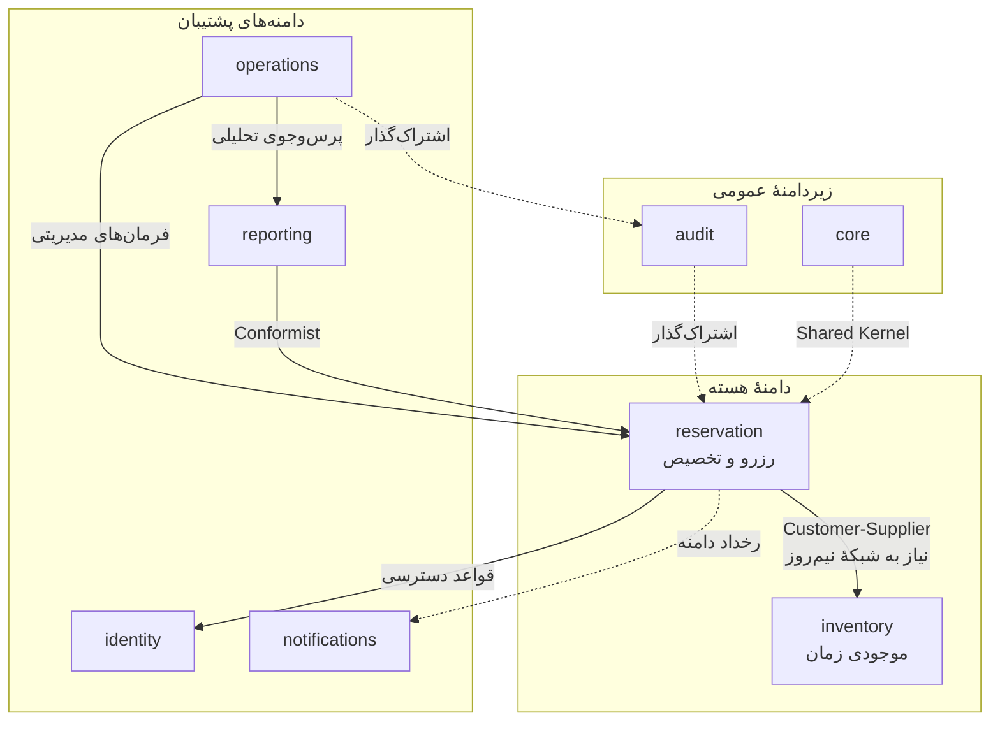
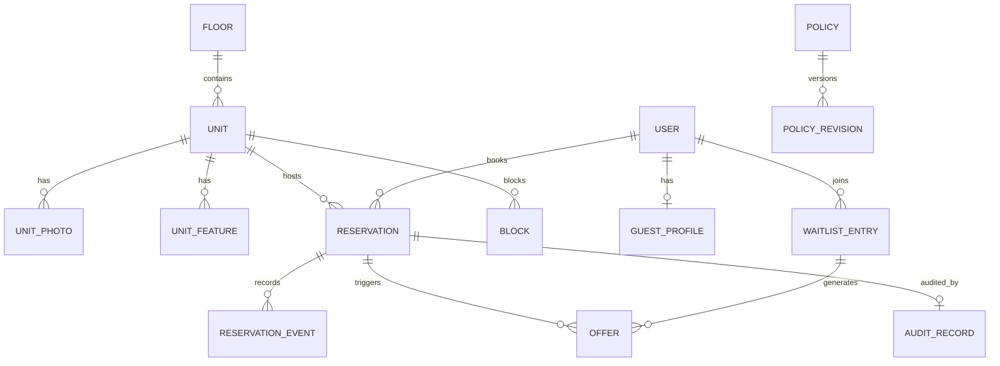
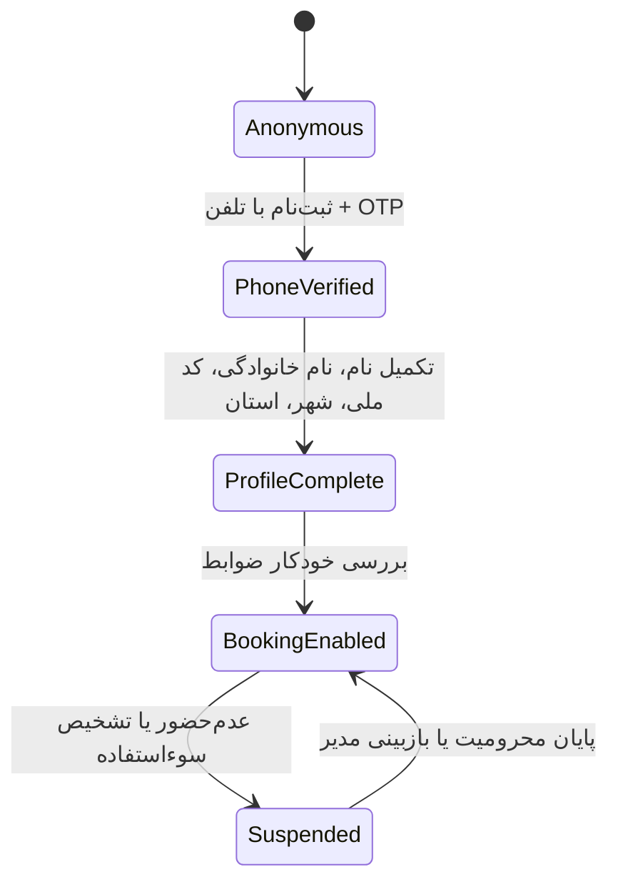

# مهدیه / Mahdieh — مدل دامنه، قواعد و ثابت‌ها

> **نسخه:** ۱.۰ · همراهِ [`00-BLUEPRINT.md`](00-BLUEPRINT.md) · زبانِ سند: فارسی، با اصطلاحات فنی انگلیسی

---

## ۱. زبان فراگیر (Ubiquitous Language)

| اصطلاح فارسی | معادل فنی | تعریف دقیق |
|---|---|---|
| زائرسرا | Property / Site | مجموعهٔ فیزیکی با ۳ طبقه |
| طبقه | Floor | سطح فیزیکی ساختمان |
| واحد | Unit | قابل‌رزروترین موجودیت فیزیکی: **سوئیت** یا **اتاق بزرگ** |
| نوع واحد | UnitType | `SUITE` یا `LARGE_ROOM` |
| نیم‌روز | Half-day cell | کوچک‌ترین واحد زمانی رزرو (پیش‌فرض ۱۲ ساعت) |
| سانس | Slot / Interval | بازهٔ پیوستهٔ نیم‌روزها که یک رزرو اشغال می‌کند |
| اقامت | Stay | بازهٔ واقعی حضور مهمان: `stay_period` |
| بازهٔ مسدودکننده | Block period | اقامت + بافر نظافت/تحویل: `block_period` — مبنای قید عدم‌همپوشانی |
| نگه‌داشت | Hold | قفل موقت کوتاه‌مدت روی سانس (برای پیشنهاد لیست انتظار یا فرم نیمه‌کاره) |
| بلوک | Block | ممانعت نگهداری/تعمیر/تعطیلی که رزرو را ناممکن می‌کند |
| رزرو | Reservation | سند تعهد بین مهمان و زائرسرا برای یک سانس |
| جابه‌جایی | Move / Supersede | تغییر واحد یا زمانِ یک رزرو با حفظ سابقه (رزرو قدیم ⇒ `Superseded`) |
| لغو | Cancel | پایان زودهنگام رزرو با آزادسازی سانس |
| عدم‌حضور | No-show | مهمان نیامد؛ سانس مصرف شد ولی اقامتی رخ نداد |
| پذیرش | Check-in | تحویل کلید به مهمان توسط کارمند |
| تخلیه | Check-out | پایان اقامت |
| سیاست | Policy | قاعدهٔ قابل‌تنظیم نسخه‌دار (مدت، ظرفیت، سهمیه، جریمه) |
| سهمیه | Quota | سقفی که موتور عادلانه روی یک کاربر/گروه در یک بازه اعمال می‌کند |
| لیست انتظار | Waitlist | صف متقاضیان یک سانس پُر |
| پیشنهاد | Offer | اجازهٔ موقت مصرف یک سانس آزادشده، با پنجرهٔ پذیرش محدود |
| مناسبت | Occasion | ایام پیک (نوروز، رمضان، محرم، صفر، اربعین) |
| پذیرش کارمند | Operator | نقش کارکنان پذیرش |
| مدیر | Manager | نقش سیاست‌گذار و گزارش‌گیر |

---

## ۲. افراز دامنه و نقشهٔ زمینه



**نقشهٔ الگوی روابط:** `reservation` مشتریِ `inventory` است (زبان شبکهٔ نیم‌روز را از آن می‌گیرد). `reporting` هم‌شکل (Conformist) با رخدادهای `reservation` است. `notifications` مصرف‌کنندهٔ رخداد است و هیچ‌گاه برعکس. `audit` اشتراک‌گذار یک‌طرفه است.

---

## ۳. مدل موجودی (inventory)

### ۳.۱ موجودیت‌ها

```text
Floor (طبقه)
  ├─ number (1..3), title, description, accessibility_notes

Unit (واحد) — ۵ رکورد
  ├─ code            نمایشی، مثل "A1"، "B2"
  ├─ floor           FK
  ├─ unit_type        SUITE | LARGE_ROOM
  ├─ title            «سوئیت طبقهٔ اول»
  ├─ capacity_adults / capacity_children  ← از Policy + قابل بازنویسی
  ├─ base_cleaning_buffer_minutes         ← بافر تحویل پیش‌فرض ۶۰ دقیقه
  ├─ is_active, deactivated_reason, deactivated_at
  ├─ sort_order, photos[], features[]
  └─ notes (فقط کارکنان)

UnitFeature (امکانات)     code, title, icon, is_highlight
UnitPhoto                 file, alt_text, sort_order, is_cover

Occasion (مناسبت/تعطیلات)
  ├─ title, kind ∈ {HOLIDAY, RELIGIOUS, SEASONAL, CUSTOM}
  ├─ date_jalali, date_gregorian
  ├─ demand_level ∈ {NORMAL, HIGH, PEAK}
  └─ is_fixed_every_year, rule (برای مناسبت‌های متغیر مثل رمضان)

Block (ممانعت)
  ├─ unit (nullable ⇒ بلوک سراسری)، period، reason (اجباری)
  ├─ kind ∈ {MAINTENANCE, CLEANING, EVENT, ADMIN}
  └─ created_by, created_at
```

### ۳.۲ شبکهٔ نیم‌روز (Time Lattice)

```text
تنظیمات پیش‌فرض (در Policy، قابل تغییر در زمان اجرا):
  grid_start_local   = 08:00     ← مرز آغاز شبکه
  cell_hours         = 12        ← طول هر سلول
  checkout_cutoff    = 12:00     ← ساعت تخلیهٔ رسمی
  checkin_cutoff     = 14:00     ← ساعت تحویل رسمی
  cleaning_buffer    = 60min     ← فاصلهٔ اجباری بین دو رزرو

تولید سلول‌ها برای تاریخ D (به‌وقت Asia/Tehran):
  سلولِ روزانه:  D 08:00 → D 20:00
  سلولِ شبانه:   D 20:00 → D+1 08:00

هر رزرو = بازهٔ پیوستهٔ [k, k+N) از این سلول‌ها، 1 ≤ N ≤ 14
```

> **چرا این مدل؟** چون هر سه الزام کارفرما را دقیقاً برآورده می‌کند: «نصف روز» = `N=1`، «یک هفته» = `N=14`، و واحد اندازه‌گیری ذاتی موجودی همین است. هیچ محاسبهٔ مدتِ اعشاری، هیچ ابهام مرزی.

### ۳.۳ قواعد تراز (Alignment Rules)

| قاعده | توضیح |
|---|---|
| A1 | هر رزرو باید از یک مرز سلول شروع و به مرز سلول ختم شود |
| A2 | ادمین می‌تواند `off_grid` را فعال کند (مثلاً مهمان ۳ ساعت دیرتر می‌آید) ⇒ ثبت اجباری دلیل + حسابرسی |
| A3 | `block_period = stay_period ± cleaning_buffer` (به‌ازای هر واحد) |
| A4 | تغییر تنظیمات شبکه، روی رزروهای موجود اثری ندارد (فقط رزروهای آیندهٔ جدید) — ثبات تاریخی |

---

## ۴. مدل رزرو (reservation)

### ۴.۱ نمودار موجودیت‌ها



### ۴.۲ فیلدهای کلیدی رزرو

```text
Reservation
├─ id                UUIDv7 (کلید اصلی)
├─ code              کد انسان‌خوان، مثل «M-1405-0231» (برای مکالمهٔ تلفنی)
├─ unit              FK → Unit
├─ guest             FK → User
├─ stay_period       tstzrange (Asia/Tehran → ذخیره UTC)
├─ block_period      tstzrange  ← مبنای قید Exclusion
├─ cells_count       تعداد نیم‌روز (تولیدشده، برای گزارش و سهمیه)
├─ guests_count      تعداد نفرات (الزام کارفرما)
├─ status            ماشین حالت بخش ۵
├─ source            WEB | PHONE | DESK | ADMIN
├─ created_by        کاربر یا کارمند (برای رزرو تلفنی)
├─ guest_note        یادداشت اختیاری مهمان
├─ staff_note        یادداشت داخلی
├─ expected_arrival  ساعت تخمینی ورود (اختیاری، UX مهم)
├─ vehicle_plate     پلاک خودرو (اختیاری، قابل خاموش‌کردن در Policy)
├─ version           قفل خوش‌بینانه
├─ superseded_by     FK → Reservation (در جابه‌جایی)
├─ cancellation      دلیل، زمان، انجام‌دهنده، جریمهٔ اعمال‌شده
└─ timestamps        created_at, updated_at, checked_in_at, checked_out_at
```

### ۴.۳ ثابت‌ها (Invariants) — و اینکه **کجا** اجرا می‌شوند

اصل ۲ سند معماری: هر ثابت در **قوی‌ترین لایهٔ ممکن** اجرا می‌شود.

| # | ثابت | لایهٔ اجرا | پیاده‌سازی |
|---|---|---|---|
| I1 | هیچ دو رزرو فعال روی یک واحد هم‌پوشانی ندارند | 🗄️ دیتابیس | `EXCLUDE USING gist (unit_id WITH =, block_period WITH &&)` |
| I2 | `cell_count` بین `min_cells` و `max_cells` سیاست است | 🗄️ دیتابیس + سرویس | `CHECK` برای کرانهٔ سخت + اعتبارسنجی سرویس با سیاست جاری |
| I3 | رزرو باید روی مرز سلول باشد | ⚙️ سرویس | اعتبارسنجی شبکه + استثنای مستند ادمین |
| I4 | تعداد نفرات ≤ ظرفیت واحد | ⚙️ سرویس | `capacity` از سیاست/واحد |
| I5 | کاربر باید پروفایل کامل داشته باشد | ⚙️ سرویس | `profile_completed_at IS NOT NULL` |
| I6 | `guests_count ≥ 1` | 🗄️ دیتابیس | `CHECK (guests_count >= 1)` |
| I7 | رزرو در گذشته ممکن نیست | ⚙️ سرویس | مقایسه با ساعت سرور (نه کلاینت) |
| I8 | افق رزرو محدود است (پیش‌فرض ۹۰ روز) | ⚙️ سرویس | سیاست `booking_horizon_days` |
| I9 | حداقل فاصله از اکنون (پیش‌فرض ۲ ساعت) | ⚙️ سرویس | سیاست `min_lead_time_hours` |
| I10 | سقف رزرو فعال هر کاربر (پیش‌فرض ۱) | ⚙️ سرویس | سیاست `max_active_reservations` |
| I11 | سقف نیم‌روز در بازهٔ چرخشی | ⚙️ سرویس | سیاست `max_cells_per_window` |
| I12 | کد ملی و تلفن یکتا (ضد حساب تکراری) | 🗄️ دیتابیس | ایندکس یکتای HMAC روی مقادیر رمزنگاری‌شده |
| I13 | هر انتقال حالت، رخداد + حسابرسی دارد | ⚙️ سرویس | سرویس + Outbox در همان تراکنش |
| I14 | دلیل برای عملیات ادمین اجباری است | ⚙️ سرویس | `reason` با حداقل طول |

---

## ۵. ماشین حالت رزرو

### ۵.۱ جدول انتقال‌ها

| از | به | مجاز برای | نگهبان (Guard) | اثرها |
|---|---|---|---|---|
| — | `hold` | کاربر | `holds_enabled` | قفل موقت + `expires_at` |
| — | `confirmed` | کاربر، کارمند | همهٔ ثابت‌های I2–I11 | Outbox + حسابرسی + پیامک تأیید |
| `hold` | `confirmed` | صاحب hold | پیش از انقضا | همان بالا |
| `hold` | `expired` | سیستم | انقضا | `block_period := empty` (آزادسازی فوری) |
| `confirmed` | `checked_in` | کارمند | امروز/ساعت پذیرش | رخداد + پیامک خوش‌آمد |
| `confirmed` | `cancelled_by_guest` | کاربر | پنجرهٔ لغو مجاز | آزادسازی + پیشنهاد به لیست انتظار |
| `confirmed` | `cancelled_by_staff` | کارمند | دلیل اجباری | آزادسازی + پیامک اطلاع + حسابرسی |
| `confirmed` | `no_show` | کارمند | گذشته از پنجرهٔ پذیرش | ثبت جریمه + رخداد |
| `confirmed` | `superseded` | کارمند | جابه‌جایی موفق | رزرو جدید + حفظ زنجیره |
| `checked_in` | `completed` | کارمند/زمان‌بند | پس از پایان بازه | آمار + دعوت به بازخورد |
| نهایی | — | — | — | `completed`, `cancelled_*`, `no_show`, `expired`, `superseded` |

### ۵.۲ قواعد نگهبان

- **پنجرهٔ لغو:** تا `policy.cancel_free_before_hours` ساعت قبل از آغاز — پس از آن «لغو دیرهنگام» علامت می‌خورد (پیش‌فرض: ۲۴ ساعت).
- **خنک‌شدن:** پس از لغو دیرهنگام، کاربر تا `policy.late_cancel_cooldown_hours` نمی‌تواند رزرو جدید بسازد (پیش‌فرض ۲۴ ساعت، قابل صفر شدن).
- **عدم‌حضور:** اگر تا `policy.no_show_grace_hours` پس از آغاز ورود ثبت نشود، کارمند می‌تواند `no_show` بزند؛ پیامد: علامت روی پروفایل + محرومیت `policy.no_show_suspension_days` (پیش‌فرض ۷ روز).
- همهٔ این‌ها **داده** هستند، نه کد ثابت.

---

## ۶. موتور تخصیص عادلانه (Fair-Use & Allocation Engine)

چون رزرو رایگان است، این موتور «قلبِ عدالت» سیستم است. همهٔ سیاست‌ها **پیش‌فرض محافظه‌کارانه و قابل خاموش‌کردن** هستند تا تجربهٔ زائر سخت نشود.

### ۶.۱ کنترل‌های فردی

| کنترل | پیش‌فرض | اثر در صورت نقض |
|---|---|---|
| سقف رزرو فعال هم‌زمان | ۱ | رد با پیام راهنما و امکان لغو رزرو قبلی |
| سقف نیم‌روز در ۳۰ روز چرخشی | ۱۴ | رد با نمایش مصرف جاری |
| سقف نیم‌روز در سال | ۶۰ | رد + امکان درخواست به مدیر |
| خنک‌شدن پس از لغو دیرهنگام | ۲۴ ساعت | تأخیر در رزرو جدید |
| محرومیت پس از عدم‌حضور | ۷ روز | پیام شفاف + امکان اعتراض به مدیر |
| حداقل فاصلهٔ بین دو رزرو متوالی | ۲۴ ساعت | جلوگیری از چرخش مداوم |

### ۶.۲ کنترل‌های ایام پیک

برای مناسبت‌های `PEAK` (نوروز، شب‌های قدر، عاشورا، اربعین) می‌توان قواعد اختصاصی تعریف کرد:

```text
AllocationRule
├─ occasion / date_range
├─ strategy ∈ {FIRST_COME, QUOTA, LOTTERY, PRIORITY_GROUP}
├─ quota_value              سهمیهٔ هر کاربر در بازه
├─ priority_groups[]        زائر اولی، خانوادهٔ شهدا، ایثارگران، … (قابل تعریف)
├─ registration_window      پنجرهٔ ثبت‌نام برای قرعه‌کشی
└─ announcement_at          زمان اعلام نتایج
```

پیش‌فرض: `FIRST_COME` (همان رفتار ساده و قابل فهم) — بقیه فقط با تصمیم کارفرما فعال می‌شوند. ساختار از روز اول هست تا فعال‌سازی، **بدون بازنویسی** ممکن باشد.

### ۶.۳ لیست انتظار و پیشنهاد خودکار (ویژگی متمایزکننده)

```text
۱. سانس پر ⇒ کاربر «مرا خبر کن» می‌زند ⇒ WaitlistEntry با اولویت زمانی
۲. یک رزرو لغو می‌شود ⇒ رخداد reservation.cancelled
۳. مصرف‌کنندهٔ پیشنهاد: به نفر اول صف یک Offer می‌سازد
   └─ Offer = Hold با پنجرهٔ پذیرش (پیش‌فرض ۳۰ دقیقه) + پیامک اطلاع
۴. کاربر با یک ضربه در «رزروهای من» پیشنهاد را می‌پذیرد ⇒ confirmed
۵. پنجره گذشت ⇒ پیشنهاد به نفر بعدی آبشاری می‌رود
```

اگر کاربر هیچ پیشنهادی را نپذیرد، پس از N پیشنهاد (پیش‌فرض ۳) از صف خارج یا به انتهای صف منتقل می‌شود — جلوگیری از قفل‌شدن صف.

---

## ۷. هویت و حریم خصوصی (identity)

### ۷.۱ چرخهٔ عمر کاربر



«باز شدن دسترسی رزرو» دقیقاً معادل وضعیت `ProfileComplete` است — همان چیزی که کارفرما توصیف کرد.

### ۷.۲ قواعد ورود اطلاعات

| فیلد | قاعده |
|---|---|
| تلفن | نرمال‌سازی به `+989xxxxxxxxx`؛ پذیرش اشکال فارسی/عربی رقم‌ها؛ یکتا |
| کد ملی | الگوریتم رسمی ۱۰ رقمی (رقم کنترلی)، رد الگوهای نامعتبر، نمایش ۴ رقم آخر |
| نام و نام خانوادگی | نرمال‌سازی فاصله و «ی/ک» عربی، حداقل ۲ و حداکثر ۵۰ نویسه، کاراکترهای مجاز فارسی/انگلیسی |
| استان | فهرست بستهٔ ۳۱ استان |
| شهر | متن آزاد با پیشنهاد خودکار + کد شهر اختیاری |
| سن/جنسیت | ❌ جمع نمی‌شود (کمینه‌سازی داده) |

### ۷.۳ طبقه‌بندی داده

| طبقه | نمونه | کنترل |
|---|---|---|
| عمومی | موجودی، امکانات، تعطیلات | کش لبه‌ای آزاد |
| شخصی | نام، شهر، تاریخ رزرو | دسترسی صاحب حساب + کارکنان حسب نیاز |
| حساس | کد ملی، تلفن کامل | رمزنگاری در سکون، نمایش پوشانده، **ممیزی هر خواندن**، ممنوعیت ورود به لاگ |

### ۷.۴ نقش‌ها (Roles) و مرز اختیارات

| نقش | می‌تواند | نمی‌تواند |
|---|---|---|
| `guest` | رزرو، لغو رزرو خود، مشاهدهٔ تاریخچهٔ خود | دیدن دادهٔ دیگران |
| `operator` | پذیرش، تخلیه، عدم‌حضور، رزرو تلفنی، ویرایش محدود، برگهٔ روز | تغییر سیاست، جابه‌جایی خارج از بازهٔ مجاز، خروج داده |
| `manager` | همهٔ اختیارات operator + سیاست‌ها، جابه‌جایی آزاد، خروجی اکسل، آمار | تغییر نقش‌ها و دسترسی‌های امنیتی |
| `admin` | همه‌چیز + مدیریت کاربران و نقش‌ها + حسابرسی | حذف سابقهٔ حسابرسی |

الزامات سطح امنیتی نقش‌های کارکنان: ورود دومرحله‌ای، «احراز تازه» (۵ دقیقهٔ گذشته) برای عملیات مخرب، الزام دلیل، و ثبت کامل زمینهٔ درخواست.

---

## ۸. فهرست رخدادهای دامنه (Event Catalog)

| رخداد | بار داده | مصرف‌کنندگان |
|---|---|---|
| `reservation.hold_created` | `reservation_id, unit, period, expires_at` | کش، آمار |
| `reservation.confirmed` | `+ guest_id, cells_count, source` | پیامک، کش، آمار، لیست انتظار |
| `reservation.cancelled` | `+ cancelled_by, reason_kind, late?` | پیامک، **پیشنهاد صف**، کش، آمار |
| `reservation.superseded` | `old_id, new_id, moved_by, reason` | پیامک، حسابرسی، کش |
| `reservation.checked_in` / `checked_out` | `reservation_id, at` | آمار، پیامک بازخورد |
| `reservation.no_show` | `reservation_id, by` | سیاست جریمه، آمار |
| `hold.expired` | `reservation_id, unit, period` | کش، صف انتظار |
| `block.created` / `block.removed` | `unit?, period, kind, reason` | کش، آمار، برگهٔ روز |
| `waitlist.joined` / `waitlist.left` | `entry_id, unit/type, period` | آمار، عملیات |
| `offer.created` / `offer.accepted` / `offer.expired` | `offer_id, entry_id, expires_at` | پیامک، کش، صف |
| `policy.published` | `policy_key, version, changed_by` | ابطال کش سیاست، حسابرسی |
| `export.requested` / `export.completed` | `export_id, params_hash, file_ref, sha256` | حسابرسی، اطلاع به ادمین |
| `identity.profile_completed` | `user_id` | فعال‌سازی رزرو، پیامک خوش‌آمد |
| `identity.suspicious_login` | `user_id, signal_kind, risk_score` | هشدار امنیتی، محدودسازی |

**قاعده:** هیچ رخدادی بدون رکورد Outbox منتشر نمی‌شود؛ هر مصرف‌کننده باید idempotent باشد (کلید یکتا = `event_id + consumer_name`).

---

## ۹. سیاست‌ها — کلیدهای استاندارد

```text
reservation.min_cells                      = 1        نصف روز
reservation.max_cells                      = 14       یک هفته
reservation.booking_horizon_days           = 90
reservation.min_lead_time_hours            = 2
reservation.cancel_free_before_hours       = 24
reservation.late_cancel_cooldown_hours     = 24
reservation.no_show_grace_hours            = 6
reservation.no_show_suspension_days        = 7
reservation.max_active_per_user            = 1
reservation.max_cells_per_window           = 14       در ۳۰ روز چرخشی
reservation.max_cells_per_year             = 60
reservation.min_gap_between_bookings_hours = 24
reservation.holds_enabled                  = false    نگه‌داشت موقت عمومی
waitlist.offer_window_minutes              = 30
waitlist.max_offers_before_requeue         = 3
lattice.grid_start_local                   = "08:00"
lattice.cell_hours                         = 12
lattice.checkin_cutoff                     = "14:00"
lattice.checkout_cutoff                    = "12:00"
lattice.default_cleaning_buffer_minutes    = 60
notification.quiet_hours                   = "23:00-07:00"
notification.reminder_lead_hours           = 24
```

هر سیاست: `key, value_json, effective_from, effective_to, version, changed_by, change_reason`. تغییر = انتشار نسخهٔ جدید (تغییرناپذیر بودن تاریخ)، با حسابرسی و ابطال کش.

---

## ۱۰. سناریوهای سرتاسری (مبنای تست‌های پذیرش)

### S1 — رزرو کامل توسط زائر جدید
```text
ورود با تلفن ⇒ OTP ⇒ تکمیل پروفایل ⇒ تقویم ⇒ انتخاب بازه (۲ نیم‌روز)
⇒ ۳ نفر ⇒ تأیید ⇒ SMS تأیید ⇒ گواهی اقامت با QR
```

### S2 — تصادم هم‌زمانی
```text
دو کاربر، یک سانس، لحظهٔ یکسان
⇒ هر دو درخواست اعتبارسنجی را پاس می‌کنند
⇒ دیتابیس یکی را می‌پذیرد، دیگری IntegrityError می‌گیرد
⇒ کاربر دوم پیام ادبانه + سانس‌های جایگزین پیشنهادی می‌بیند
⇒ متریک reservation.conflict_total افزایش می‌یابد
```

### S3 — لغو و آبشار صف
```text
رزرو لغو می‌شود ⇒ سانس آزاد ⇒ نفر اول لیست انتظار پیامک می‌گیرد
⇒ پنجرهٔ ۳۰ دقیقه‌ای پذیرش ⇒ پذیرش با یک ضربه ⇒ تأیید
⇒ اگر نپذیرفت ⇒ نفر بعدی
```

### S4 — جابه‌جایی توسط مدیر
```text
مدیر رزرو را از سوئیت ۱ به اتاق بزرگ ۲ و یک روز جلوتر می‌برد
⇒ پیش‌نمایش تفاوت (واحد، تاریخ، نفرات، اثر بر سایر رزروها)
⇒ تأیید + دلیل اجباری ⇒ رزرو قدیم Superseded، جدید Confirmed
⇒ پیامک اطلاع به مهمان ⇒ هر دو رکورد در حسابرسی، زنجیره حفظ شده
```

### S5 — عدم‌حضور
```text
پایان پنجرهٔ پذیرش ⇒ کارمند «عدم‌حضور» می‌زند ⇒ سانس مصرف‌شده علامت می‌خورد
⇒ پروفایل مهمان علامت می‌گیرد ⇒ محرومیت موقت ۷ روزه ⇒ آمار عدم‌حضور به‌روز
```

### S6 — خروجی اکسل مدیر
```text
انتخاب بازهٔ جلالی ۱۴۰۵/۰۱/۰۱ تا ۱۴۰۵/۰۳/۳۱ + گروه‌بندی ماهانه
⇒ کار پس‌زمینه ⇒ فایل ۷ برگی با نمودار، RTL، قالب‌بندی شرطی
⇒ لینک امضاشدهٔ ۲۴ ساعته + ثبت در حسابرسی با هش داده
```

### S7 — بلوک نگهداری
```text
مدیر یک هفته بلوک تعمیر روی سوئیت ۲ می‌گذارد (دلیل اجباری)
⇒ تقویم عمومی فوراً آن را «غیرقابل‌رزرو» نشان می‌دهد و برچسب «تعمیر» می‌خورد
⇒ رزروهای همپوشان از قبل وجود ندارند (قید دیتابیس اجازه نمی‌دهد)
```

### S8 — حملهٔ OTP
```text
۲۵ درخواست کد برای یک شماره در ۱۰ دقیقه
⇒ سقف فعال می‌شود، backoff نمایی
⇒ پس از ۵ تلاش ناموفق تأیید، قفل موقت شماره
⇒ هشدار هزینه به مدیر ⇒ هیچ‌گاه کد در لاگ یا پیام خطا فاش نمی‌شود
```

---

## ۱۱. نگاشت به ماژول‌های کد

| مفهوم دامنه | ماژول | مدل‌ها |
|---|---|---|
| طبقه، واحد، امکانات، مناسبت، بلوک | `inventory` | `Floor, Unit, UnitFeature, UnitPhoto, Occasion, Block` |
| رزرو، حالت، سیاست، سهمیه، صف، پیشنهاد | `reservation` | `Reservation, ReservationEvent, Policy, PolicyRevision, WaitlistEntry, Offer, AllocationRule` |
| کاربر، پروفایل، OTP، نشست، نقش | `identity` | `User, GuestProfile, OtpChallenge, Session, Device, Role` |
| اعلان و پیامک | `notifications` | `NotificationIntent, SmsTemplate, SmsDelivery, SmsProviderConfig` |
| کنسول، خروجی اکسل، گواهی | `operations` | `ExportJob, ExportPreset, VoucherDocument` |
| آمار و نماهای خواندنی | `reporting` | `OccupancyDaily, GuestScorecard` (نماهای مادی‌شده) |
| حسابرسی | `audit` | `AuditRecord, AuditAnchor` |
| هستهٔ مشترک | `core` | `BaseModel, OutboxEvent, IdempotencyKey, RequestLog` |
